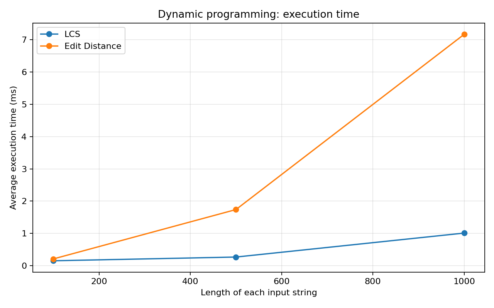
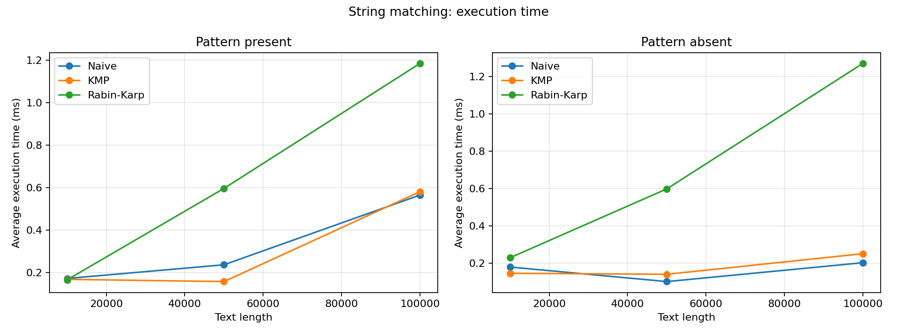

# Assignment 4 - Text Analysis

**Name:** Tolendi Meiirzhan  
**Group:** SE-2539  
**Language:** Java

## 1. Task

The task was to implement and compare algorithms used for comparing strings and searching text. I implemented LCS, Edit Distance, Naive matching, KMP, Rabin-Karp, and Kasai's algorithm for the LCP array. Then I tested the algorithms and measured how their running times change with the input size.

## 2. Project files

```text
src/
    LCS.java
    EditDistance.java
    NaiveMatcher.java
    KMPMatcher.java
    RabinKarpMatcher.java
    SearchResult.java
    Kasai.java
    SuffixArray.java
    AlgorithmTests.java
    Benchmarks.java
results/
    results.csv
    dp_times.png
    matching_times.png
plot_results.py
README.md
.gitignore
```

`SuffixArray.java` is only a simple helper for preparing the input to Kasai's algorithm. Its running time is not included in the Kasai experiments.

## 3. Algorithms and implementation

### Longest Common Subsequence (LCS)

LCS finds the length of the longest subsequence that occurs in both strings in the same order. Characters do not need to be next to each other.

I used a table `dp[i][j]` for the LCS length of the first `i` and `j` characters. The first row and column are zero, because an empty string has no common subsequence with another string.

- If the last characters match: `dp[i][j] = dp[i-1][j-1] + 1`.
- Otherwise: `dp[i][j] = max(dp[i-1][j], dp[i][j-1])`.

This works because a matching last character can extend the common subsequence. If the characters differ, the answer must exclude at least one of those two characters.

### Edit Distance

Edit Distance counts the minimum insertions, deletions, or substitutions required to change one string into another. Each operation costs one.

`dp[i][j]` is the minimum cost to change the first `i` characters of the first string into the first `j` characters of the second.

The base cases are `dp[i][0] = i` and `dp[0][j] = j`. For other cells:

```text
cost = 0 if a[i-1] == b[j-1], otherwise 1

dp[i][j] = min(
    dp[i-1][j] + 1,         // delete
    dp[i][j-1] + 1,         // insert
    dp[i-1][j-1] + cost     // match or substitute
)
```

The recurrence is correct because every possible last edit is covered by one of these choices. The table stores the minimum result for each smaller problem.

### Naive string matching

The Naive algorithm tries to match the pattern at every possible starting position in the text. It stops checking a position as soon as a character does not match. It is easy to implement but may compare the same text characters many times.

### KMP

KMP first builds the LPS array (longest proper prefix which is also a suffix). When a mismatch occurs, it uses the LPS value to decide how much of the pattern can still match. It does not restart from the beginning of the pattern after every mismatch, which avoids unnecessary repeated comparisons.

### Rabin-Karp

Rabin-Karp calculates a hash for the pattern and each text window of the same length. The next window hash is updated using the previous hash instead of calculating everything again. I used base `256` and modulus `1000000007`.

A matching hash does not always mean the actual strings are equal. The code compares the characters after a hash match, so a hash collision cannot give a false occurrence. This check is the reason the worst case can still take `O(nm)` time.

### Kasai's LCP algorithm

The suffix array stores the starting positions of all suffixes in sorted order. The LCP array stores the lengths of common prefixes between neighboring suffixes in that order. `lcp[0] = 0`, since the first suffix has no previous suffix.

Kasai builds a rank array to find each suffix's position in the suffix array. It reuses the previous common-prefix length, decreasing it by at most one before checking the next suffix. This keeps the total work linear.

For example, for `banana`:

```text
Suffix array: [5, 3, 1, 0, 4, 2]
LCP array:    [0, 1, 3, 0, 0, 2]
```

The first suffixes in sorted order are `a`, `ana`, and `anana`, so the next two LCP values are `1` and `3`.

## 4. Complexity analysis

Here `n` is the text length (or first string length), `m` is the pattern length (or second string length), and `k` is the number of matches returned. The string-matching bounds below assume `m <= n` and a nonempty pattern.

| Algorithm | Main operation / recurrence | Preprocessing | Best-case time | Worst-case time | Auxiliary space | Explanation |
|---|---|---|---|---|---|---|
| LCS | Match: diagonal + 1; otherwise max(top, left) | None | O(nm) | O(nm) | O(nm) | Every DP cell is filled once. |
| Edit Distance | Minimum of insert, delete, substitute | None | O(nm) | O(nm) | O(nm) | Every DP cell needs a constant amount of work. |
| Naive | Compare pattern at each starting position | O(1) | O(n) | O(nm) | O(1) | Early mismatches are cheap; long partial matches repeat work. |
| KMP | Text comparisons and LPS fallback | O(m) | O(n + m) | O(n + m) | O(m) | The text index does not move backward and LPS skips repeated work. |
| Rabin-Karp | Rolling hash and verification on hash matches | O(m) | O(n + m) | O(nm) | O(1) | Hash updates are constant time, but verification can take O(m) per window. |
| Kasai | Rank lookup and reused common-prefix length | O(n) for rank | O(n) | O(n) | O(n) | The reused prefix limits total character checks. |

For the three matching methods specifically, Naive has `O(1)` preprocessing and `O(n)` best / `O(nm)` worst search time. KMP spends `O(m)` on LPS preprocessing and then searches in `O(n)` even in the worst case. Rabin-Karp spends `O(m)` on initial hashes and the search is normally `O(n)` with few candidate checks, but can be `O(nm)` with many collisions or real matches.

These space bounds exclude the output list of indices for string matching (which needs `O(k)` space). For Kasai, the `O(n)` space includes the rank array, validation array, and output LCP array. For Rabin-Karp, `O(n + m)` is also the usual expected running time when there are few hash collisions and few full matches; even without collisions, many real matches can require extra verification.

## 5. Assumptions

- Strings are compared case-sensitively using Java `char` values.
- Search results contain **all** matching starting indices, including overlapping matches. Indexing starts from zero.
- An empty pattern matches at every boundary of the text, so for text length `n` the answer is `[0, 1, ..., n]`.
- A nonempty pattern longer than the text returns an empty list.
- The LCP algorithm receives a valid sorted suffix array. The small helper in `SuffixArray.java` uses direct suffix comparisons and is **not** an optimized suffix-array construction method.
- The experimental alphabet is `abcd`. For the absent matching case I used only `z` characters in the pattern, so the pattern is guaranteed not to occur.

## 6. Tests

I wrote `AlgorithmTests.java` using simple checks so that no testing library is needed. The code stops with an error if a test fails.

| Algorithm | Cases tested | Result |
|---|---|---|
| LCS | Identical, different, empty, standard example | Passed |
| Edit Distance | Identical, empty on either side, substitution, insertion, deletion, standard example | Passed |
| Naive / KMP / Rabin-Karp | Beginning, middle, end, overlapping matches, absent, longer pattern, empty pattern, empty text | Passed |
| Kasai | `banana` with manually checked suffix and LCP arrays, repeated letters, empty string, one character | Passed |

For every matching test, I compared the returned indices from all three search methods against the same expected list.

**Test run:** `All 25 tests passed.`

## 7. Experimental setup

- Java: OpenJDK 21
- Environment used for the supplied results: Linux x86_64 (AMD EPYC 9V74)
- Random seed: `20261108` (Java `Random`)
- Random alphabet: `abcd` for all generated texts and DP inputs
- LCS and Edit Distance: two strings, each of length **100, 500, 1000**
- String matching: text length **10000, 50000, 100000**, pattern length **24**
- Matching cases: present pattern copied from the middle of each text; absent pattern is 24 `z` characters
- Kasai: text length **1000, 5000, 10000**
- For each case: **15 warm-up calls** and **5 timed calls**, with the average reported in milliseconds
- Timing: `System.nanoTime()` around the algorithm call only. String creation, suffix-array construction, result printing, and file writing are outside the timed region.

The three string matchers use exactly the same text and pattern for every comparison. Their output lists are checked against each other before timing. JVM warm-up helps reduce the effect of first-time class loading and compilation, but short measurements can still vary between runs.

For operation counts, DP records the number of inner table cells (`n*m`). Naive and KMP record character comparisons (KMP includes LPS construction). Rabin-Karp records character comparisons during candidate verification separately from hash-window checks and hash collisions. Kasai records suffix-character comparisons. These counts come from the implementations, not from a formula added to the result afterward (except the directly known number of DP cells).

## 8. Experimental results

All values below are the **average time in milliseconds**, measured using the source code in this repository. Full raw summary data is available in [`results/results.csv`](results/results.csv).

### LCS and Edit Distance

| String length (each) | LCS (ms) | Edit Distance (ms) |
|---:|---:|---:|
| 100 | 0.1499 | 0.2076 |
| 500 | 0.2657 | 1.7380 |
| 1000 | 1.0089 | 7.1713 |



### String matching

| Text length | Pattern | Naive (ms) | KMP (ms) | Rabin-Karp (ms) |
|---:|---|---:|---:|---:|
| 10,000 | present | 0.1711 | 0.1670 | 0.1650 |
| 10,000 | absent | 0.1786 | 0.1451 | 0.2286 |
| 50,000 | present | 0.2355 | 0.1564 | 0.5951 |
| 50,000 | absent | 0.1006 | 0.1397 | 0.5979 |
| 100,000 | present | 0.5638 | 0.5798 | 1.1838 |
| 100,000 | absent | 0.2018 | 0.2502 | 1.2709 |



For a closer look at the comparison counts, here are the results for text length `100000`:

| Pattern | Algorithm | Character comparisons | Hash checks | Hash collisions |
|---|---|---:|---:|---:|
| present | Naive | 133,322 | 0 | 0 |
| present | KMP | 124,545 | 0 | 0 |
| present | Rabin-Karp | 24 | 99,977 | 0 |
| absent | Naive | 99,977 | 0 | 0 |
| absent | KMP | 100,023 | 0 | 0 |
| absent | Rabin-Karp | 0 | 99,977 | 0 |

### Kasai

| String length | Kasai (ms) | Character comparisons |
|---:|---:|---:|
| 1,000 | 0.1680 | 1,990 |
| 5,000 | 0.1544 | 9,989 |
| 10,000 | 0.1551 | 19,988 |

The suffix array was created before the Kasai timing started.

## 9. Discussion

The LCS and Edit Distance timings generally increase as the strings become longer. Their dynamic programming tables have `n*m` cells, so doubling both lengths requires about four times as many cells. Edit Distance was slower than LCS in these runs because it computes three candidate costs per cell, while LCS uses a simpler comparison and maximum.

On the random matching data, Naive and KMP were quite close. Naive can work well when a mismatch happens quickly. KMP has extra work to prepare LPS, but its worst-case time is better because it avoids trying the same partial match again. Rabin-Karp spent time updating and checking window hashes, even when the pattern was absent. It made very few character comparisons, but fewer comparisons did not automatically mean less execution time.

For the absent pattern, no full matches were found. Rabin-Karp also had zero reported hash collisions on these inputs. The experimental results do not prove Rabin-Karp is always slower: the result depends on text, pattern, hash values, and the number of candidate matches.

Kasai's character-comparison count was close to twice the input length, which agrees with its linear-time analysis. The measured times for Kasai were small and did not rise smoothly; at this scale the JVM and measurement noise can hide some of the increase. The complexity analysis describes how work grows in general, while these measurements show what happened on this particular machine and dataset.

## 10. Conclusion

Dynamic programming gives reliable answers for LCS and Edit Distance but uses a two-dimensional table, so memory usage increases with both input lengths. Naive matching is the simplest method and can be fast on easy data, but its worst case is slow. KMP needs extra preprocessing and an LPS array but guarantees linear matching time. Rabin-Karp is useful when rolling hashes can reduce unnecessary character checks, although verification is still needed for correctness. Kasai calculates the LCP array in linear time when the suffix array has already been provided.

